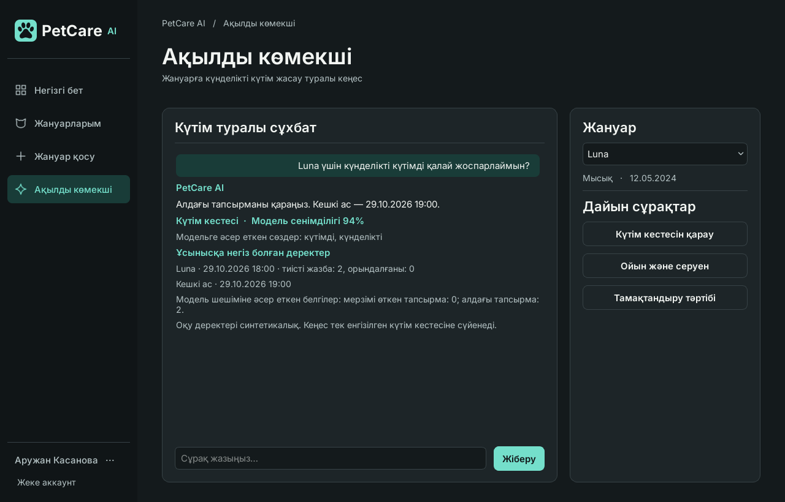

# PetCare AI

Үй жануарларының күтімін жоспарлауға арналған қазақша Windows қолданбасы. Чатта Касанова Аружанның моделі сұрақтың тақырыбын анықтайды, ал Кенже Балнұрдың моделі таңдалған жануардың SQLite журналынан келесі күтім әрекетін ұсынады.



## Windows-та іске қосу

GitHub-тағы осы тармақты **Code → Download ZIP** арқылы жүктеп, архивті ашыңыз. `requirements.txt` тұрған бумада PowerShell ашып, Python 3.12 үшін мына командаларды орындаңыз. Python 3.11 қолдансаңыз, бірінші командада `-3.11` көрсетіңіз.

```powershell
py -3.12 -m venv .venv
.\.venv\Scripts\python.exe -m pip install -r requirements.txt
.\.venv\Scripts\python.exe -m petcare --demo
```

Демода 10 жануар бар. Уақыт 29.10.2026, 18:00 деп бекітілген. Демо өзгерістері терезе жабылғанша сақталады. Жеке аккаунтпен тұрақты жұмыс істеу үшін `--demo` параметрін алып тастап, «Аккаунт ашу» батырмасын басыңыз. Windows-та деректер `%LOCALAPPDATA%/PetCareAI/petcare.sqlite3` файлына жазылады.

## Аружанның модулін көрсету

1. «Ақылды көмекші» бөлімінен Luna-ны таңдап, **«Келесі тамақтандыру қашан?»** деп жазыңыз. Чат сұрақтың санатын және модель сүйенген сөздерді көрсетеді. Балнұрдың кеңесшісі Luna журналы бойынша «Кешкі ас» тапсырмасының уақытын **19:00** деп көрсетеді. Дайын сұрақ батырмалары да сол екі модельден өтеді.
2. «Ауа райы қандай?» деп сұраңыз. Көмекші күтім кестесі, тамақтандыру немесе ойын туралы нақтылауды сұрайды. Басқа жануарды таңдағанда оның жеке тарихы ашылады.
3. Бүйір мәзірдің төменінде аккаунт батырмасын басып, «Күтім жоспарларын салыстыру» тармағын ашыңыз. Бастапқы екі жоспар үшін уақытқа сәйкестік пен күтім жиілігінің салмақтары 0,6 және 0,4. А жоспары `60 + 20 = 80`, Б жоспары `30 + 40 = 70` ұпай жинайды. Мәндерді өзгертіп, үшінші жоспарды қосуға болады. Ұпайлар тең болса, екеуіне бірдей орын беріледі.
4. «Жануарларым» бөлімінде аты, түрі немесе тұқымы бойынша іздеңіз. Жануарды қосып, өзгертіп немесе жоюды растай аласыз. Аккаунт мәзірінде еске салғыштар, апталық күтім, әрекеттер тарихы, есепті CSV/JSON түрінде алдын ала қарап сақтау және CSV есебін поштаға жіберу бар.

Аружанның моделі 60 тұжырым тобына бөлінген 120 синтетикалық сұрақпен үйретілді. Үйрету мен баптаудан бөлек бақылауда қалыпты қазақша сұрақтардың 8/12-сін, ауызекі сұрақтардың 11/12-сін дұрыс таныды. Қалған бес сұрақта чат нақтылауды сұрады. Екіұшты немесе тақырыптан тыс 12/12 сұрақта нақтылау күтілген нәтиже болды. Сұрақтар мен нақты болжамдарды [Аружанның модель картасынан](petcare/ai/intent/model_card.md) және [жеке бағалау нәтижелерінен](petcare/ai/intent/evaluation.json) көруге болады.

## Екі модельді қайта үйрету және тесттерді жүргізу

```powershell
.\.venv\Scripts\python.exe -m petcare.ai.intent.train
.\.venv\Scripts\python.exe -m petcare.ai.adviser.train
.\.venv\Scripts\python.exe -m pytest -q
```

Аружанның сұрақ жіктеуі таңбалық TF-IDF және логистикалық регрессияны қолданады. Балнұрдың бөлек шешім ағашы күтім журналы бойынша жоспарды толықтыру, алдағы істі қарау немесе мерзімі өткен істі қайта жоспарлау әрекетін таңдайды. [Балнұрдың модель картасы](petcare/ai/adviser/model_card.md) · [Екі қатысушының жұмыс жоспары](TEAM_IMPLEMENTATION_PLAN.md)

## Пошта және интерфейс

Шынайы пошта үшін `PETCARE_SMTP_HOST`, `PETCARE_SMTP_FROM` және пошта қызметі талап етсе `PETCARE_SMTP_USER`, `PETCARE_SMTP_PASSWORD` орта айнымалыларын баптаңыз. Әдепкі жіберу режимі — STARTTLS және 587-порт. SSL үшін `PETCARE_SMTP_MODE=ssl` қолданылады. Тесттер хат мазмұнын және тасымалдау қатесін имитацияланған SMTP арқылы тексереді.

Бес экранның жұмыс істеп тұрған PySide6 қолданбасынан алынған суреттері көрсетілімге арналған. [Экрандар](docs/README.md) · [Figma макеті](https://www.figma.com/design/7mDGqaX9GiRE6OVNBaOMdI?node-id=6-3) · [Inter қарпінің лицензиясы](petcare/ui/fonts/OFL.txt)
